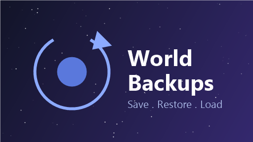
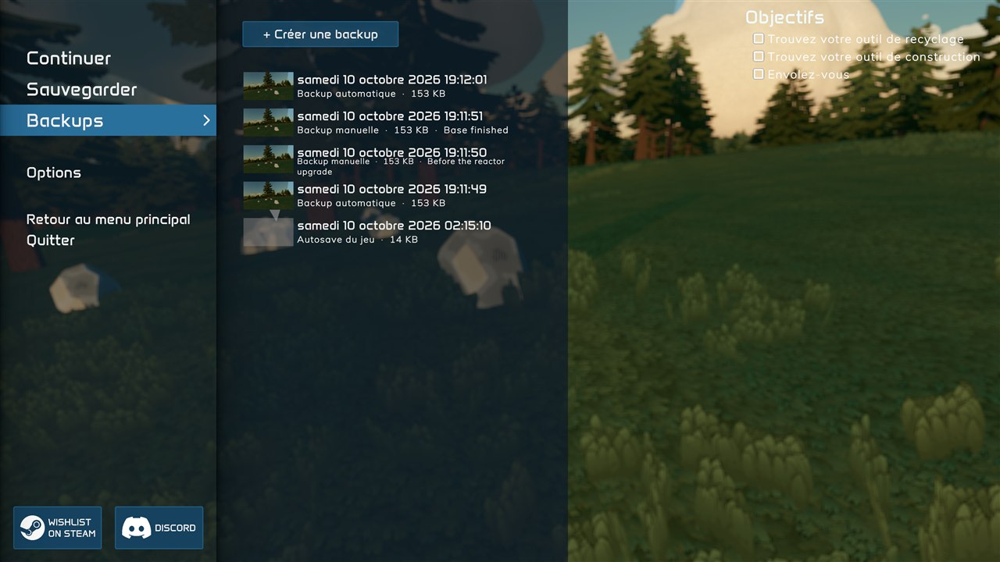
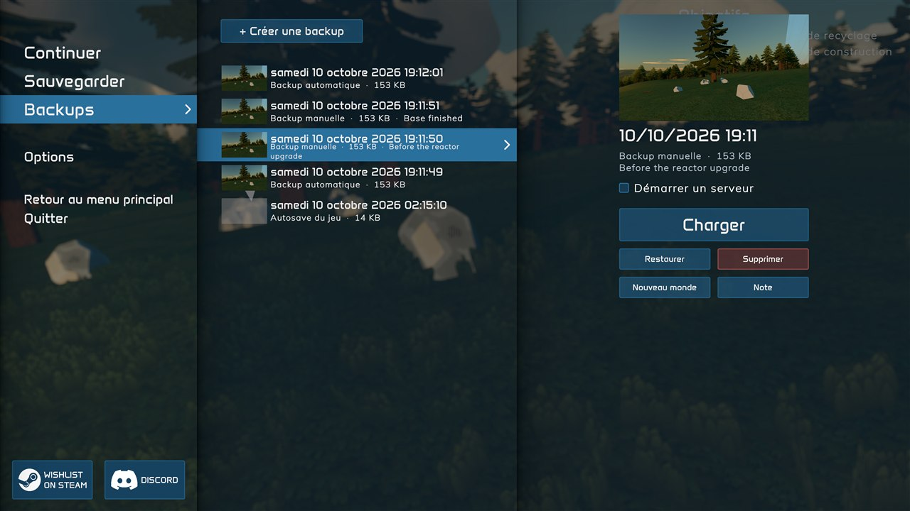
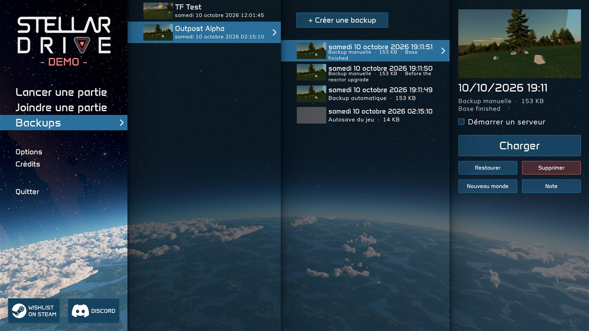

# World Backups — StellarDrive mod

A MelonLoader mod for **StellarDrive (Demo)** to create, browse, restore and load backups of your worlds.
Packaged for [Stellar Mod Manager](https://github.com/jollyname/StellarModManager).



## Screenshots

**Escape menu** — the current world's backups:



**Backup details** — screenshot, note, and the *Load*, *Restore*, *Delete*, *New world* and *Note* actions:



**Main menu** — pick a world, then one of its backups:



## Features

- **Native menus** — the screens are built from the game's own menu pieces (world rows with thumbnails, world details panel, delete and rename dialogs), so they look and behave like the rest of StellarDrive.
- **Escape menu** — a *Backups* entry under *Save* opens the current world's backups, then a backup's details: screenshot, *Load*, *Restore*, *Delete*, *New world*, *Note*.
- **Main menu** — a *Backups* entry under *Join game*: pick a world, then one of its backups.
- **Manual backups** (*+ Create a backup*) with an optional note. On the world you are playing, the game is saved first, so the backup holds the latest state.
- **Automatic backup** each time you load one of your worlds (the 10 most recent are kept per world).
- **Load** — restores a backup into its world and launches it straight away (solo, or hosting on Steam if the toggle is on).
- **Restore** — puts the world back to that backup without launching it.
- **New world** — restores a backup as a separate world, so the original stays untouched.
- **Safety backup** — before any restore, the current state of the world is backed up first (5 kept per world), so a restore can always be undone.
- The game's own rolling autosaves (`backup_*.json`, made every 10 minutes) are listed too, and can be restored or deleted.
- English and French text (follows the language chosen in the game options).

From inside a game, *Load* saves the current game, goes back to the main menu, restores the backup and relaunches the world. *Restore* on the world you are playing does the same but stays in the main menu. Restoring another world, or restoring as a new world, happens right away.

## Where backups live

```
%USERPROFILE%\AppData\LocalLow\CuriousOwlGames\StellarDrive\
├── WorldSaves\<world>\world.json        ← the game's worlds
└── WorldBackups\<world>\<date>\         ← this mod's backups (a full copy of the world folder)
```

Each backup is a plain copy of the world folder plus a `backup-info.json`, so you can also copy one back by hand.

## Settings

`UserData/MelonPreferences.cfg`, section `[WorldBackups]`:

| Key | Default | Meaning |
| --- | --- | --- |
| `AutoBackupOnWorldLoad` | `true` | Make a backup each time a world is loaded |
| `MaxAutoBackupsPerWorld` | `10` | Automatic backups kept per world (0 = all) |
| `SafetyBackupBeforeRestore` | `true` | Back up the world before it is overwritten |
| `MaxSafetyBackupsPerWorld` | `5` | Safety backups kept per world (0 = all) |
| `ShowMainMenuButton` | `true` | Add the Backups entry to the main menu |
| `Language` | `auto` | `auto` (game language), `en` or `fr` |

## Building

Needs the .NET SDK (6+), the game, and MelonLoader 0.7.x installed in the game folder (Stellar Mod Manager installs it for you).

```powershell
./build.ps1                                   # default Steam path
./build.ps1 -GamePath "D:\SteamLibrary\steamapps\common\StellarDrive Demo"
```

This produces `dist/StellarDrive-WorldBackups.zip` in the layout Stellar Mod Manager expects:

```
mod.json
Mods/WorldBackups.dll
```

## Publishing to Stellar Mod Manager

1. Push this folder to a GitHub repo named `StellarDrive-WorldBackups` (branch `main`), keeping `Mods/mod.json` and `Mods/Thumbnail.png`.
2. Create a release tagged `v1.0.0` (must match `version` in `mod.json`) and attach `StellarDrive-WorldBackups.zip` (the asset name must be `<repo>.zip`).
3. Open a PR on [jollyname/StellarModRepository](https://github.com/jollyname/StellarModRepository) adding to `mods.json`:

```json
{ "author": "<your GitHub user>", "repo": "StellarDrive-WorldBackups", "metadata": "Mods" }
```

For a new version: bump `version` in `Mods/mod.json` and in `MelonInfo` (`src/WorldBackupsMod.cs`) and in the csproj, then publish a `v<version>` release with the new zip.
